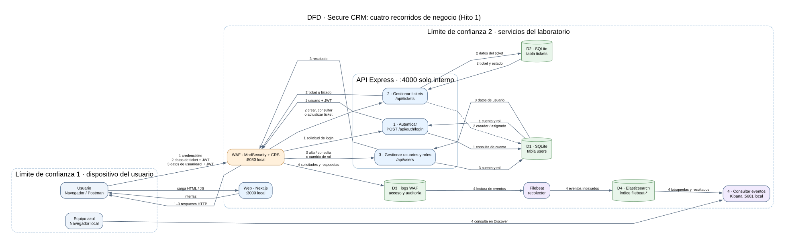

# Hito 1 · Diseño seguro de Secure CRM

Aplicación del grupo: Secure CRM, la misma del laboratorio DAST. Este documento modela el entorno local del [Hito 0](../hito-0/README.md). Las vulnerabilidades descritas proceden del código y de la guía DAST del repositorio; su explotación, clasificación final y evidencias por el WAF corresponden al Hito 2.

| Integrante | Equipo | Responsabilidad en H1 |
|---|---|---|
| Davis Roldán | Rojo | Reconocimiento, superficie de ataque y hallazgos DAST |
| Julio Lemus | Rojo | Revisión de hallazgos DAST para las pruebas de H2 |
| Andre Marroquín | Azul | Requisitos y controles de verificación |
| Gabriel Paz | Azul | Límites de confianza y controles de monitoreo |

El DFD, STRIDE y PASTA se revisan entre los cuatro. El mapa de superficie de ataque y los hallazgos DAST del Equipo rojo están incorporados en este hito.

## 1. DFD y límites de confianza



[Fuente editable del diagrama](dfd.dot).

El mismo DFD reúne cuatro casos de negocio en orden. Sus números se mantienen en PASTA, en la descomposición y en la matriz de riesgos de este documento. Los tres primeros comparten el WAF y la API; el cuarto recibe eventos de esas solicitudes.

| Orden | Recorrido | Datos que entran y salen | Resultado de negocio |
|---|---|---|---|
| 1 | Autenticación | Credenciales → WAF → login de la API → usuarios en SQLite; regresan usuario y JWT. | Proteger la identidad y la entrada al CRM. |
| 2 | Gestión de tickets | JWT y datos de cliente/ticket → WAF → API → tickets en SQLite; regresan el ticket, su estado o un listado. | Atender solicitudes sin divulgar ni alterar datos de clientes. |
| 3 | Gestión de usuarios y roles | JWT y datos de cuenta/rol → WAF → API → usuarios en SQLite; regresa el resultado. | Mantener separados los permisos de administración y atención. |
| 4 | Consulta de actividad | Solicitudes de los casos anteriores → logs WAF → Filebeat → Elasticsearch; Kibana devuelve eventos al Equipo azul. | Investigar abusos y sostener la continuidad del servicio. |

El orden 1–3 representa una secuencia habitual de uso, no una comunicación directa entre procesos: el navegador conserva el JWT y envía una nueva solicitud para tickets o usuarios. La consulta de eventos se alimenta de cualquiera de esos recorridos. D1 y D2 son tablas de la misma base SQLite, dibujadas por separado para mostrar qué datos utiliza cada proceso. El diagrama describe cómo funciona el laboratorio en H1; los permisos inseguros identificados en STRIDE y DAST siguen siendo hallazgos, no controles ya corregidos.

**Procesos y almacenes.** El navegador carga la web Next.js en `127.0.0.1:3000`. La web usa `NEXT_PUBLIC_API_URL=http://localhost:8080`, por lo que sus peticiones a la API cruzan ModSecurity y OWASP CRS. El WAF reenvía a Express en la red interna de Docker; la API lee y escribe usuarios y tickets en SQLite. Los logs de acceso y auditoría del WAF pasan por Filebeat a Elasticsearch y se consultan en Kibana.

**Límite 1, usuario → servicios locales.** El navegador, Postman y sus datos de entrada no son confiables. El WAF y Kibana solo publican puertos en `127.0.0.1`; la web también. La API no publica el `4000` al host en esta configuración. Las cuentas de prueba no son datos de producción.

**Límite 2, WAF → API y datos.** La API recibe datos incluso cuando el WAF está en `DetectionOnly`: observar una petición no la vuelve segura. Express debe autenticar y autorizar cada operación y tratar como no confiables los parámetros que luego llegan a SQLite. SQLite y los registros del WAF son almacenes distintos. Los logs de auditoría pueden incluir el cuerpo de un login; por ello solo se envían credenciales de prueba.

**Límite 3, telemetría → análisis.** Filebeat lee el volumen de logs del WAF y envía eventos a Elasticsearch. Kibana consulta esos eventos. Esta cadena ayuda a detectar y reconstruir incidentes, pero no sustituye la autorización de la API. Elasticsearch y Kibana tienen seguridad deshabilitada en la plantilla de laboratorio y sus puertos se limitan a la laptop.

## 2. STRIDE por componente

| Caso | Letra | Amenaza concreta | Componente y flujo del DFD | Control requerido y comprobación posterior |
|---|---|---|---|---|
| 1; amplifica 2 y 3 | S · Suplantación | Un token JWT alterado se acepta sin validar su firma y permite fingir otra identidad. | Navegador → WAF → `authenticate` de Express. | Verificar firma, expiración y algoritmo; prueba de regresión con token alterado en H4 y revisión SAST en H2. |
| 2 y 3 | T · Manipulación | Un usuario envía `role=admin` o modifica campos de un ticket que no debe controlar. | Cuerpo HTTP → rutas `/api/users` y `/api/tickets` → SQLite. | Autorizar por rol y por objeto, validar campos permitidos; pruebas de acceso en H4 y observación del WAF en H3. |
| 4 | R · Repudio | Una creación, edición o eliminación de ticket no queda atribuida en un registro de auditoría de la aplicación. | API → SQLite; WAF → logs. | Registrar actor, operación, objeto, hora y resultado sin secretos; correlacionar con eventos en Kibana en H3. |
| 2 y 3 | I · Divulgación | Un usuario `viewer` consulta tickets ajenos o recibe hashes de contraseñas en `/api/users`. | API → SQLite → respuesta al navegador. | Proyección de respuesta sin hashes y autorización por objeto; prueba HTTP en H4, alerta de acceso anómalo en H3. |
| 1 y 4 | D · Denegación de servicio | La ruta de login acepta intentos ilimitados; una ráfaga consume recursos y permite fuerza bruta. | Navegador → WAF → `/api/auth/login` → SQLite. | Limitar intentos en API y detectar ráfagas en Kibana; revisar disponibilidad y falsos positivos en H3/H4. |
| 3 | E · Elevación de privilegios | Cualquier usuario autenticado puede crear usuarios con rol administrativo o cambiar roles. | `/api/users` y `/api/users/:id/role` → SQLite. | Autorizar operaciones administrativas en la API y probar que `viewer` recibe 403 en H4; búsqueda de eventos en H3. |

## 3. PASTA, etapas 1 a 5

### Etapa 1 · Objetivos del negocio

Secure CRM gestiona solicitudes de clientes, asignaciones y estados de tickets. Para modelar el recorrido de los datos se identificaron cuatro objetivos, numerados como en el DFD:

1. **Proteger el acceso al CRM:** vincular cada sesión a una identidad válida para que una persona ajena no opere como empleado o administrador. Activos: credenciales, cuentas y sesiones.
2. **Atender solicitudes sin comprometer al cliente:** crear, consultar y actualizar tickets preservando sus datos de contacto, contenido y estado. Activos: tickets y continuidad de atención.
3. **Separar funciones y privilegios:** reservar la administración de cuentas y roles a personal autorizado. Activos: directorio de usuarios y permisos.
4. **Poder investigar abusos y fallas:** conservar actividad consultable y atribuible para detectar problemas y reconstruir qué ocurrió. Activos: registros, evidencias y capacidad de respuesta.

Los activos principales son los datos de contacto del cliente, el contenido de tickets, las cuentas y roles, y la continuidad de atención. Una alteración de roles o tickets puede cambiar la atención al cliente; una fuga expone datos de contacto y asuntos internos.

El uso en este curso es local y con datos de prueba. La disponibilidad y trazabilidad se evalúan sobre el laboratorio; no se infiere que la aplicación esté lista para producción.

### Etapa 2 · Alcance técnico

| Elemento | Incluido | Límite o decisión |
|---|---|---|
| Web | Next.js 14, rutas de login, panel, tickets y administración | Puerto `3000` solo local; peticiones de API por `8080` |
| WAF | ModSecurity + OWASP CRS | `DetectionOnly` en H0–H2; registra sin bloquear |
| API | Express + TypeScript, JWT y rutas `/api/*` | Puerto `4000` solo en la red de Docker |
| Datos | SQLite con usuarios y tickets de prueba | Base dentro del contenedor; la semilla se restaura al arrancar |
| Observabilidad | Logs WAF → Filebeat → Elasticsearch → Kibana | Puertos `9200` y `5601` solo locales |
| Fuera de alcance | Servicios públicos, datos reales y sistemas de terceros | No se escanean ni se atacan |

### Etapa 3 · Descomposición de la aplicación

| Caso del DFD | Actor, entrada y proceso | Almacén y salida | Límite donde se decide la confianza |
|---|---|---|---|
| 1 · Acceso | Visitante envía usuario y contraseña a `POST /api/auth/login` por el WAF. | La API consulta `users` en SQLite y devuelve cuenta y JWT; el navegador guarda el JWT en `localStorage`. | Cliente → WAF → API: la API debe validar credenciales y, después, la firma de cada token. |
| 2 · Tickets | Usuario autenticado envía JWT, búsqueda `q`, identificador o cuerpo del ticket a `/api/tickets`. | La API consulta o modifica `tickets` y relaciona creador/asignado con `users`; devuelve ticket, lista o estado. | Cliente → API → SQLite: se debe validar entrada, rol y acceso al ticket concreto. |
| 3 · Usuarios | Usuario autenticado envía JWT y datos de cuenta o rol a `/api/users`. | La API consulta o modifica `users`; devuelve datos de cuenta o resultado del cambio. | Cliente → API → SQLite: se debe autorizar la operación administrativa y limitar los campos de salida. |
| 4 · Investigación | El WAF registra solicitudes y el Equipo azul busca eventos en Kibana. | Logs WAF → Filebeat → Elasticsearch → Kibana; vuelve un resultado de búsqueda al analista. | Tráfico → registro → SIEM: hacen falta eventos completos, atribuibles y sin secretos. |

Los cuatro casos comparten los mismos componentes del [DFD](dfd.svg). Un usuario normalmente ejecuta el caso 1 antes de los casos 2 o 3; el caso 4 observa cualquiera de ellos. El WAF ve HTTP, pero no puede decidir por sí solo la propiedad de un ticket ni el permiso de cambiar un rol.

### Etapa 4 · Análisis de amenazas

Los actores son un visitante sin sesión, un usuario `viewer`, un agente y un administrador; para el laboratorio, el Equipo rojo simula abuso de esos niveles de acceso. Los puntos de entrada son el login, el parámetro de búsqueda, los identificadores de tickets y usuarios, los cuerpos JSON y el token de sesión. Las rutas administrativas y de tickets requieren comprobar el rol y, cuando corresponda, la pertenencia del objeto. El WAF observa patrones HTTP, pero no conoce por sí mismo quién es dueño de un ticket.

Las amenazas se agrupan por los cuatro casos del DFD: acceso indebido por SQLi, JWT alterado o fuerza bruta; divulgación/manipulación de tickets por IDOR o XSS; elevación de privilegios y exposición de hashes en usuarios; y pérdida de atribución si la telemetría no registra actor, objeto y resultado. La [matriz por caso](#trazabilidad-por-caso-de-negocio) conecta cada amenaza con su efecto para el negocio, evidencia, requisito y caso de abuso. El último riesgo es una brecha de diseño de auditoría: no se presenta como uno de los diez hallazgos DAST confirmados.

### Etapa 5 · Vulnerabilidades del Proyecto DAST

Estos son hallazgos confirmados contra la instancia local via WAF (`http://localhost:8080`). Ver [hallazgos-dast.md](hallazgos-dast.md) para la evidencia completa de petición y respuesta de cada uno (Davis Roldán, Equipo rojo, 2026-11-04).

| Evidencia | Caso del DFD | Ubicación y efecto |
|---|---|---|
| H-01 · SQLi en login | 1 | `auth.ts`: la entrada altera la consulta a `users` y permite acceder sin contraseña válida. |
| H-02 · XSS reflejado en búsqueda | 2 | `/api/tickets?q=` devuelve texto no confiable que la web refleja al usuario. |
| H-03 · IDOR de tickets | 2 | `routes/tickets.ts` devuelve un ticket ajeno sin verificar su propietario. |
| H-04 · JWT sin verificar | 1; también 2 y 3 | `middleware/auth.ts` acepta identidad/rol del token sin comprobar su firma. |
| H-05 · Hashes expuestos | 3 | `routes/users.ts` incluye `passwordHash` en respuestas de usuarios. |
| H-06 · Cabeceras/cookie inseguras | 1; transversal | Las respuestas y la cookie carecen de protecciones; aumenta el riesgo para sesiones y navegador. |
| H-07 · CORS permisivo | 1–3 | `index.ts` permite solicitudes con credenciales desde orígenes arbitrarios. |
| H-08 · Asignación de rol sin control | 3 | `routes/users.ts` acepta un rol administrativo del cliente sin verificar permiso. |
| H-09 · Login sin límite de intentos | 1; afecta 4 | `auth.ts` permite intentos repetidos que amenazan cuentas y disponibilidad. |
| H-10 · Errores detallados | 1–3 | `auth.ts`/`index.ts` pueden exponer SQL o detalles internos en la respuesta. |

El código de búsqueda también concatena `q` en SQL, y el ZAP de H2 lo señaló con confianza baja. No se cuenta aquí como una undécima explotación confirmada. La evidencia H-02 es de XSS **reflejado**; este listado no afirma una PoC de XSS almacenado.

## 4. Superficie de ataque · Equipo rojo


[Fuente editable del diagrama](superficie.dot) · [Tabla detallada con entradas, salidas y vulnerabilidades](superficie.md)

El mapa fue construido a partir del código fuente de `apps/api/src/`. Las rutas, métodos, roles, entradas y salidas se derivaron de los archivos `auth.ts`, `middleware/auth.ts`, `routes/tickets.ts`, `routes/users.ts` y `routes/dashboard.ts`. Los hallazgos se corresponden con las diez vulnerabilidades del tablero DAST de la guía del curso.

**Hallazgo global crítico:** el middleware `authenticate` usa `jwt.decode()` en lugar de `jwt.verify()`, por lo que la firma del token nunca se valida. Cualquier usuario puede forjar un token con el rol que quiera. Esto compromete todas las rutas autenticadas (CVSS 9.1).

**Verificación de puertos confirmada desde el host (Mac con Docker):**

```bash
# Responde por el WAF — HTTP 200
curl -s http://localhost:8080/api/health

# Puerto 4000 no publicado — conexión rechazada
curl -s http://localhost:4000/api/health
```

El puerto `4000` no está publicado al host en la configuración actual del `docker-compose.yml` (`expose` sin `ports`). No se detectó bypass directo a la API.

**Tres candidatos para los PoC del Hito 2** (derivados del análisis del código y del CVSS):

| Prioridad | Hallazgo | Ruta | CVSS |
|---|---|---|---|
| 1 | JWT sin verificación de firma | Middleware / todas las rutas autenticadas | 9.1 Crítica |
| 2 | SQL Injection en login | `POST /api/auth/login` | 9.1 Crítica |
| 3 | IDOR en tickets | `GET /PUT /DELETE /api/tickets/:id` | 8.1 Alta |

La [lista de entrega para el Equipo rojo](PENDIENTE-RED-TEAM.md) queda cubierta con este mapa. Los PoC, escaneos ZAP/Burp, cálculo de CVSS completo y la clasificación final corresponden al Hito 2.

## 5. Requisitos de seguridad verificables

En H1, el Equipo azul definió estos criterios de seguridad y cómo comprobarlos. La implementación y la evidencia de cada control se documentan en los hitos correspondientes; esta tabla no afirma que todas las vulnerabilidades ya estén corregidas.

| Caso | ID | Requisito | Amenaza | Control que lo comprueba | Criterio observable posterior |
|---|---|---|---|---|---|
| 1 | RS-01 | La API debe rechazar JWT con firma alterada o vencidos. | Suplantación | Prueba de regresión H4; SAST del pipeline H2 | Token adulterado → 401; token válido → 200. |
| 3 | RS-02 | Solo un administrador debe crear usuarios o cambiar roles. | Elevación | Prueba de autorización H4; búsqueda de llamadas en Kibana H3 | `viewer`/`agent` → 403; `admin` → resultado permitido. |
| 2 | RS-03 | Cada lectura o cambio de ticket debe comprobar acceso al objeto. | IDOR / manipulación | Pruebas con dos usuarios H4; detección en Kibana H3 | Ticket ajeno → 403/404; propio → 200. |
| 3 | RS-04 | Las respuestas de usuarios no deben incluir hashes. | Divulgación | Prueba de contrato H4; revisión SAST H2 | Ningún JSON de `/api/users*` contiene `passwordHash`. |
| 1 y 2 | RS-05 | Búsquedas y login deben usar parámetros SQL y codificar salida HTML. | Inyección / XSS | SAST H2, WAF y PoC repetido en H4 | El PoC no cambia la consulta ni ejecuta script. |
| 1 y 4 | RS-06 | Login debe limitar ráfagas por cuenta y origen. | Denegación / fuerza bruta | Regla de Kibana y prueba de límite H3/H4 | Exceso de intentos → 429 o bloqueo temporal, con evento investigable. |
| 4 | RS-07 | Las operaciones relevantes deben registrar actor, resultado, objeto y hora sin secretos. | Repudio | Búsqueda en Kibana H3 y revisión de logs | Se correlaciona la acción con el actor; no aparecen contraseñas ni tokens. |
| 1–4 | RS-08 | Las llamadas normales a la API deben pasar por el WAF. | Bypass del control | Prueba de red H0; evidencia en Kibana H3 | `8080/api/health` → 200; acceso directo a `4000` desde host → conexión rechazada. |

## 6. Casos de abuso

### CA-01 · Suplantar identidad con token alterado

- **Dado** un cliente que posee un JWT de prueba de rol `viewer`.
- **Cuando** altera los datos del token y solicita una ruta administrativa por el WAF.
- **Entonces** la API debe rechazarlo con 401, sin modificar datos, y dejar evidencia de la solicitud.

### CA-02 · Leer un ticket ajeno

- **Dado** dos agentes con tickets asignados a personas diferentes.
- **Cuando** uno consulta por el WAF el identificador del ticket del otro.
- **Entonces** la API debe negar la lectura sin revelar el contenido del ticket.

### CA-03 · Escalar privilegios mediante el cuerpo JSON

- **Dado** un usuario autenticado con rol de solo lectura.
- **Cuando** intenta crear una cuenta con `role=admin` o cambiar el rol de otra cuenta.
- **Entonces** la API debe devolver 403 y no cambiar la tabla de usuarios.

### CA-04 · Inyección en login o búsqueda

- **Dado** un visitante o un agente con acceso al formulario correspondiente.
- **Cuando** envía caracteres de control SQL en el usuario o en `q` a través del WAF.
- **Entonces** la aplicación debe tratar la entrada como dato, sin cambiar la consulta ni devolver detalles internos.

### CA-05 · Ejecutar script desde un ticket

- **Dado** un ticket con texto aportado por un usuario de prueba.
- **Cuando** otra persona abre la lista o el detalle del ticket en el navegador.
- **Entonces** el texto debe mostrarse como contenido inerte y no ejecutar JavaScript.

### CA-06 · Saturar el inicio de sesión

- **Dado** una cuenta de prueba y un origen local.
- **Cuando** se repiten intentos fallidos de login en poco tiempo por el WAF.
- **Entonces** la API debe limitar los intentos y el Equipo azul debe poder identificar la ráfaga en el SIEM.

### CA-07 · Actuar sin trazabilidad suficiente

- **Dado** un usuario de prueba que modifica un ticket o un rol.
- **Cuando** el Equipo azul busca esa acción por hora, ruta y objeto en el SIEM.
- **Entonces** debe poder identificar actor, operación, objeto y resultado sin encontrar contraseñas ni tokens en los registros.

## Trazabilidad por caso de negocio

La secuencia es **objetivo → proceso y datos del DFD → amenaza STRIDE → debilidad observada → impacto de negocio → requisito y prueba**. Los identificadores H remiten a las peticiones y respuestas de [hallazgos DAST](hallazgos-dast.md); CA describe el comportamiento que se debe impedir, no una protección que ya funcione.

### Caso 1 · Acceso e identidad

- **Objetivo y descomposición:** una persona envía credenciales al login; la API consulta `users`, crea una sesión y recibe después el JWT en cada solicitud protegida. Activos: cuentas, credenciales y sesión. El límite crítico es cliente → WAF → autenticación de la API.
- **Amenazas y debilidades:** suplantación (S) mediante H-01 SQLi en login o H-04 JWT sin firma verificada; denegación/abuso de autenticación (D) por H-09 intentos ilimitados. H-06, H-07 y H-10 agravan la exposición de sesión y detalles internos. Un WAF en `DetectionOnly` registra el tráfico, pero no reemplaza la validación de la API.
- **Impacto de negocio:** un intruso puede entrar como otra persona o administrador, leer o cambiar tickets y cuentas, o dificultar el ingreso legítimo. Se pierde la confianza en la identidad asociada a las operaciones.
- **Respuesta verificable:** RS-01, RS-05 y RS-06; CA-01, CA-04 y CA-06. H2 documenta PoC de JWT forjado y SQLi en login; H4 debe repetirlas tras las correcciones y obtener rechazo sin acceso indebido.

### Caso 2 · Atención de tickets

- **Objetivo y descomposición:** un usuario autenticado envía token, identificador, búsqueda o contenido del ticket; la API consulta o modifica `tickets` en SQLite y devuelve datos del cliente y estado. El límite crítico es cliente → API → objeto solicitado.
- **Amenazas y debilidades:** divulgación (I) confirmada por H-03 IDOR en la lectura; las rutas `PUT` y `DELETE` sin control de objeto presentan además un riesgo de manipulación (T) observado en el código. H-02 expone XSS reflejado en la búsqueda. El parámetro `q` concatenado en SQL es otro riesgo de código; la alerta ZAP de H2 tuvo confianza baja y requiere contraste con una PoC específica.
- **Impacto de negocio:** se expone información de clientes o se altera una solicitud ajena, afectando confidencialidad, integridad y continuidad de atención. El XSS puede comprometer la sesión de quien consulta el ticket.
- **Respuesta verificable:** RS-03 y RS-05; CA-02, CA-04 y CA-05. H2 confirmó IDOR con Burp/Postman; las pruebas posteriores deben negar tickets ajenos y tratar entradas y salidas como datos.

### Caso 3 · Administración de usuarios y roles

- **Objetivo y descomposición:** una persona autenticada envía token y datos de cuenta o rol; `/api/users` consulta o cambia la tabla `users` y devuelve una respuesta. El límite crítico es la autorización por función y la selección de campos antes de responder.
- **Amenazas y debilidades:** elevación (E) y manipulación (T) por H-08 asignación de rol sin control; divulgación (I) por H-05 hashes incluidos en la respuesta. H-04 permite forjar el rol del token y amplifica ambos riesgos.
- **Impacto de negocio:** alguien con acceso de lectura puede obtener privilegios administrativos, modificar cuentas y consultar datos de autenticación de otros usuarios; la separación de funciones deja de ser confiable.
- **Respuesta verificable:** RS-02 y RS-04; CA-03. H2 mostró acceso a `/api/users` con JWT forjado; una regresión debe negar cambios administrativos a `viewer` y excluir `passwordHash` de las respuestas.

### Caso 4 · Investigación y continuidad

- **Objetivo y descomposición:** el WAF emite logs de acceso/auditoría; Filebeat los envía a Elasticsearch y el Equipo azul busca eventos en Kibana. El límite crítico es tráfico → registro → análisis: cada evento debe poder relacionarse con una acción sin exponer secretos.
- **Amenazas y debilidades:** repudio (R) si los registros no contienen actor, objeto y resultado; pérdida de visibilidad ante fallas de recolección. Los intentos ilimitados de H-09 también generan carga y requieren detección. **La falta de auditoría atribuible es un riesgo de diseño identificado con STRIDE, no uno de los diez hallazgos DAST H-01–H-10.**
- **Impacto de negocio:** el grupo no puede explicar quién modificó un ticket o rol ni responder a tiempo a abusos; una ráfaga de login puede dificultar la atención.
- **Respuesta verificable:** RS-06, RS-07 y RS-08; CA-06 y CA-07. H0 demostró que el WAF y el SIEM reciben tráfico; H3/H4 deben comprobar correlación, contenido seguro del log y detección de ráfagas.

**Cobertura transversal:** H-06 (cabeceras/cookie), H-07 (CORS) y H-10 (errores verbosos) afectan varios casos; se describen en la etapa 5 y se revisan en el control de respuestas de la API. Su presencia no se confunde con una explotación independiente de cada caso. El acceso directo al puerto `4000` desde el host está cerrado en este Compose, como exige RS-08.

Este diseño no presupone resultados de H2–H4. Los controles y criterios permiten comprobarlos cuando se ejecuten. El mapa de superficie de ataque y los hallazgos DAST del Equipo rojo están incorporados en las secciones 3 y 4.
